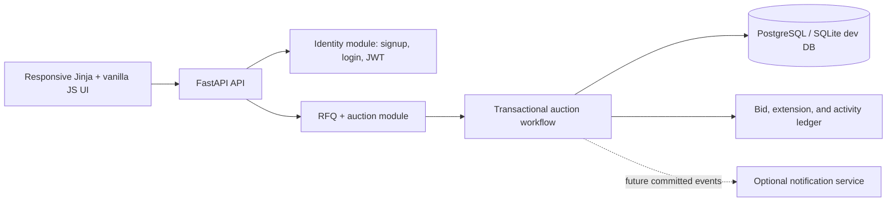

# FreightFlow RFQ & British Reverse Auction

FreightFlow is a FastAPI + async SQLAlchemy application for buyer-created RFQs and supplier-led British reverse auctions. The canonical comparison amount is `freight_charges + origin_charges + destination_charges`, stored as `NUMERIC(18,2)`. Ranking uses each supplier's best accepted quote, then earliest server-side acceptance time, then bid ID for deterministic ties.

## Architecture

The current deployment is a modular monolith: authentication/identity and RFQ/auction are separate API domains, while the auction write path stays in one process and one database transaction. Bid acceptance, ranking, deadline validation, extensions, and audit events must agree atomically, so splitting those writes into networked services would introduce failure and consistency cases without a current scaling need. If independent scaling becomes necessary, notifications and reporting are the first good microservice candidates because they can consume committed auction events without participating in bid acceptance.



The database is the source of truth. A bid transaction locks the RFQ row where the database supports row locks, checks the database/server deadline, validates a strictly lower supplier quote, recalculates rankings, applies the configured extension if eligible, and writes audit records before commit. `idempotency_key` is unique per supplier/RFQ so safe client retries do not create duplicate submissions.

## Business rules

- Auction IDs are assigned by the server from the database sequence; buyers enter the auction name, schedule, and supplier-facing remarks, not an ID.
- Buyer remarks are stored with the RFQ and shown in both buyer and supplier detail views. Account history records buyer RFQ creation and supplier quotation submissions.
- Buyer lists and detail views are scoped to RFQs owned by that buyer. Suppliers can browse RFQs and see only their own quote amounts.
- All API timestamps must include a timezone and are normalized to UTC.
- An auction starts at `bid_start_at`, naturally closes at `current_close_at`, and becomes `force_closed` at `forced_close_at`. The forced deadline is absolute.
- A supplier may submit a new bid only when it is strictly below that supplier's best accepted quote.
- L1/L2/L3 are calculated from one best accepted quote per supplier. Ties use earliest accepted server-side timestamp, then bid ID.
- Extension modes are `bid_received`, `rank_change`, and `l1_change`. The trigger window is evaluated relative to the current close, repeated extensions are allowed, and close time is capped at the forced close.
- Buyers can see all accepted quotation details. Suppliers can see auction progress and their own accepted quotations, but not competitor quote details.

## Local setup

Requires Python 3.12+ and [uv](https://docs.astral.sh/uv/).

```powershell
copy .env.example .env
# Set SECRET_KEY in .env to a generated value, for example:
python -c "import secrets; print(secrets.token_urlsafe(48))"
uv sync
uv run alembic upgrade head
uv run fastapi dev main.py
```

Open http://localhost:8000. Public signup lets users choose a buyer or supplier account. Weak-password choices prompt a recommendation modal but remain allowed. Buyer dashboards show only RFQs created by that buyer; supplier dashboards show the open RFQ marketplace. Both roles have a profile/account page.

## User data and senior administration

Create or promote the senior administrator with `uv run python scripts/create_admin.py`. The script prompts for username, email, and a hidden password, then stores only an Argon2 password hash. The administrator can browse the server-rendered directory at `/admin/users` and inspect a user’s profile and account activity. Browser requests without admin access receive a Jinja HTML error page.

The OpenAPI docs group role-specific account APIs under **Buyers**, **Suppliers**, and **Admin**. Buyers use `GET /api/buyers/me` and `/api/buyers/me/activity`; suppliers use `GET /api/suppliers/me` and `/api/suppliers/me/activity`. Admin-only endpoints are `GET /api/admin/users`, `/api/admin/buyers/{id}`, and `/api/admin/suppliers/{id}`. Buyer, supplier, and admin detail responses have separate schemas; none include password hashes. Buyer and supplier endpoints are scoped to the signed-in person, and admin endpoints require the senior-admin flag.

## Docker

```powershell
# Set SECRET_KEY in .env before starting; Compose refuses its known-default fallback.
docker compose up --build
```

PostgreSQL data is persisted in the `postgres_data` volume. The container runs `alembic upgrade head` before starting FastAPI, runs as a non-root user, does not bake secrets into the image, and exposes `/health`.

### Free-tier deployment notes (checked 2026-11-20)

For a demo or evaluation deployment, run the Docker image as a Render Free Web Service and point `DATABASE_URL` at a separate managed PostgreSQL provider. Render Free Web Services sleep after 15 minutes without inbound traffic, have an ephemeral filesystem, and may take about a minute to wake; therefore do not put the authoritative auction database on local SQLite in that environment. Render's own Free Postgres is limited to 1 GB, expires after 30 days, and has no backups, so it is not the durable choice for this database. See [Render's free deployment limits](https://render.com/docs/free).

Supabase Free is a practical PostgreSQL option for a small demo: the current published limits include 500 MB database size, 5 GB egress, two free projects, and pausing after one week of inactivity; automatic backups are not included. Treat it as evaluation infrastructure, keep the database URL in host secrets, and plan backups/upgrades before production use. See [Supabase billing limits](https://supabase.com/docs/guides/platform/billing-on-supabase) and [database size behavior](https://supabase.com/docs/guides/platform/database-size).

## Tests

```powershell
uv run pytest -q
```

The test suite uses a temporary SQLite database, API authorization checks, monetary precision, rank/tie behavior, trigger modes, forced-close rules, idempotent retries, and concurrent submission coverage.
