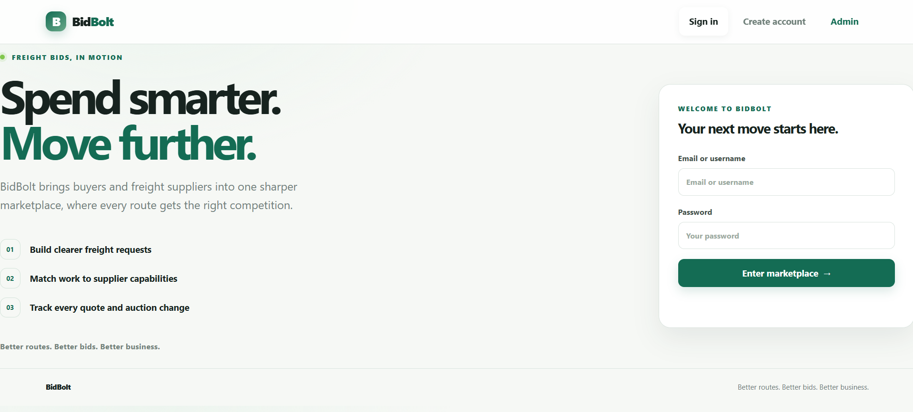
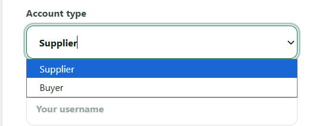
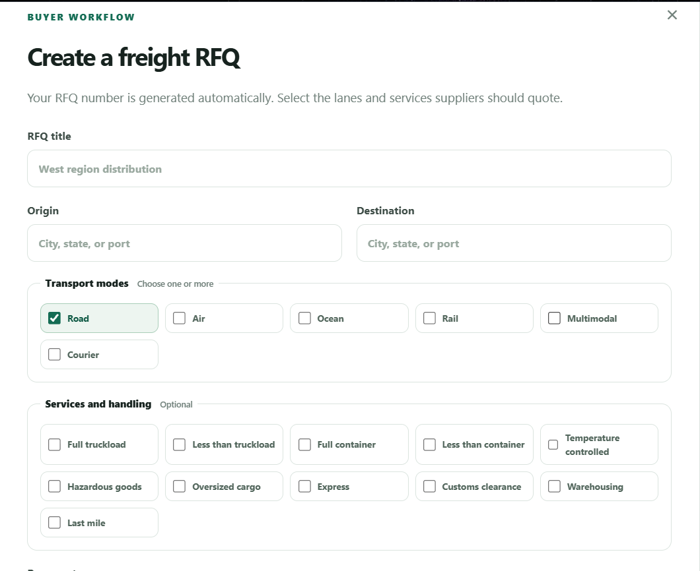
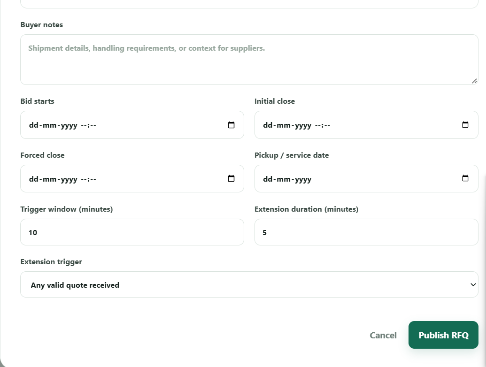
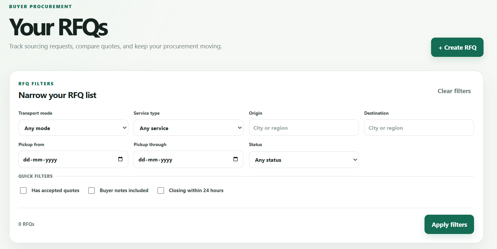
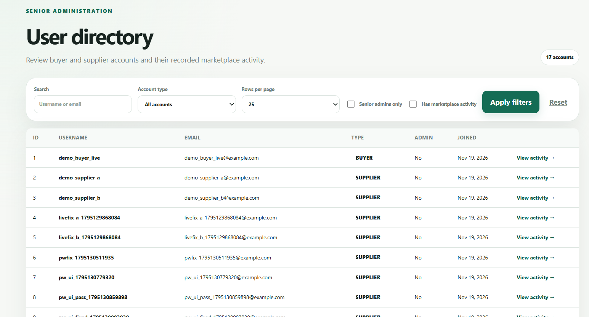
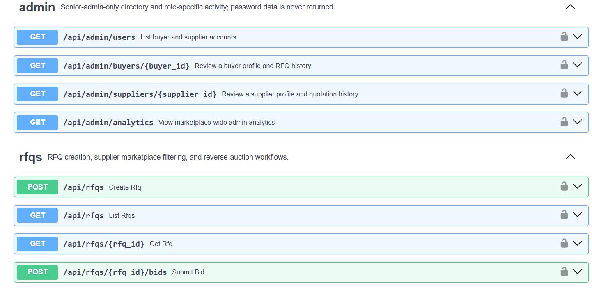
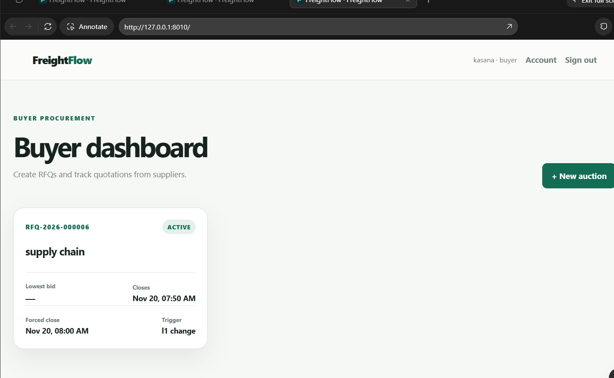
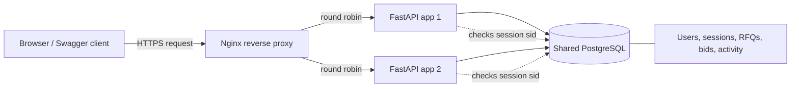
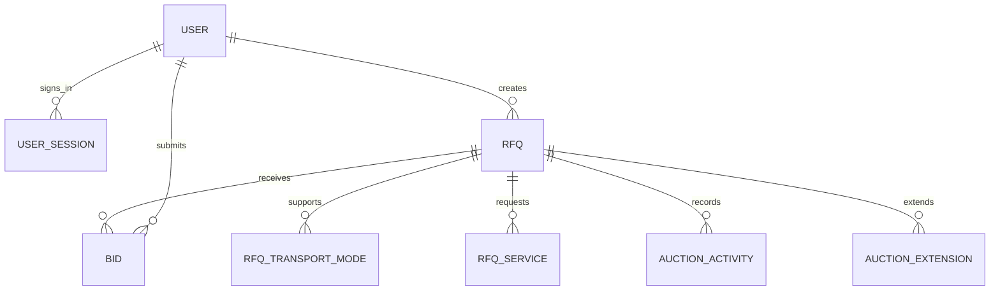

<div align="center">

# BidBolt
### Better routes. Better bids. Better business.

**Freight RFQs and British reverse auctions for buyers and suppliers.**


</div>

> **A note about the demo:** We’re sorry the public website wasn’t ready in time. Time constraints delayed deployment. We’re working to deploy it today; until then, this repository documents the working local application and its deployment setup.

---

## Contents

- [Product](#product)
- [Screenshots](#screenshots)
- [How it works](#how-it-works)
- [Technology](#technology)
- [Security concepts](#security-concepts)
- [Data model and ORM](#data-model-and-orm)
- [API overview](#api-overview)
- [Run locally](#run-locally)
- [Run with Docker](#run-with-docker)
- [System design roadmap](#system-design-roadmap)
- [Project structure](#project-structure)
- [Tests](#tests)

## Product

BidBolt connects freight buyers who need a shipment moved with suppliers who can serve that lane. A buyer creates a Request for Quotation (RFQ), describes the shipment and requirements, chooses transport modes and services, and opens a timed reverse auction. Eligible suppliers find RFQs using marketplace filters and submit quotes. The lowest accepted quote ranks first (L1), with deterministic tie-breaking.

### What’s included

| Area | Capabilities |
| --- | --- |
| Buyer workspace | Create RFQs, add supplier-facing remarks, track bids, view analytics and activity |
| Supplier workspace | Filter and match RFQs by lane, mode, service and pickup date; submit and track quotes |
| Auction rules | Server-generated RFQ IDs, timed bidding, forced-close cap, configurable extensions, rankings |
| Administration | Search accounts, inspect buyer/supplier activity, review auctions and marketplace analytics |
| Data access | Role-scoped APIs, pagination, separate public and admin response schemas |

## Screenshots

Screenshots are stored under [`docs/images/`](docs/images/). Each caption describes the screen’s purpose in the buyer, supplier, admin or developer workflow.

<table>
  <tr>
    <td width="50%"><br><strong>Landing page and sign-in</strong><br><sub>Entry point for existing users. The top navigation offers sign-in, account creation and a separate administrator entry.</sub></td>
    <td width="50%"><br><strong>Create an account</strong><br><sub>Signup collects identity and password, then assigns the account a buyer or supplier role. Public signup cannot grant administrator privileges.</sub></td>
  </tr>
  <tr>
    <td><br><strong>Choose account type</strong><br><sub>The role choice determines which dashboard and role-protected API operations the account can use.</sub></td>
    <td><br><strong>Admin sign-in</strong><br><sub>Separate, restricted entry for the senior administrator and marketplace-wide oversight.</sub></td>
  </tr>
  <tr>
    <td><br><strong>Describe the shipment</strong><br><sub>The buyer enters the lane, chooses transport modes and optional service requirements. These category selections power supplier-side filtering.</sub></td>
    <td><br><strong>Set auction rules</strong><br><sub>Remarks give suppliers context. Start, initial close, forced close, trigger window and extension policy define the reverse-auction schedule.</sub></td>
  </tr>
  <tr>
    <td><br><strong>RFQ list and filters</strong><br><sub>Search by lane, dates, transport, service and status; quick filters narrow the list to auctions with bids, remarks or an approaching close.</sub></td>
    <td><br><strong>Account and activity</strong><br><sub>Shows the signed-in person’s profile and history. Buyer history includes RFQs created by that buyer.</sub></td>
  </tr>
  <tr>
    <td><br><strong>Admin overview</strong><br><sub>Summarizes accounts, buyers, suppliers, RFQs, accepted quotes and auction status with activity visualizations.</sub></td>
    <td><br><strong>User directory</strong><br><sub>Admins can search and filter account records, paginate results, and open a user’s role-specific activity history.</sub></td>
  </tr>
  <tr>
    <td><br><strong>FastAPI Swagger UI</strong><br><sub>Open `/docs` to explore the generated OpenAPI contract: request fields, validation rules, response schemas, status codes and endpoint groups.</sub></td>
    <td><br><strong>Authorize API calls</strong><br><sub>The Swagger authorization dialog requests a normal account’s username and password at `/api/auth/token`, then sends the bearer token for protected requests.</sub></td>
  </tr>
  <tr>
    <td><br><strong>Buyer and supplier API groups</strong><br><sub>Profile, activity and analytics endpoints are scoped to the authenticated role; supplier capability updates use `PUT`.</sub></td>
    <td><br><strong>Admin and RFQ API groups</strong><br><sub>Admin routes expose protected directory/analytics operations. RFQ routes create auctions, browse/filter requests and submit supplier bids.</sub></td>
  </tr>
  <tr>
    <td><br><strong>Earlier buyer dashboard</strong><br><sub>A historical preview of the buyer’s active RFQs and close-time information.</sub></td>
    <td><br><strong>Form detail capture</strong><br><sub>A small supplemental crop from the RFQ creation flow.</sub></td>
  </tr>
</table>

## How it works

1. A buyer creates an RFQ with origin, destination, pickup date, transport mode, services, remarks and auction timing.
2. The server assigns the RFQ ID and stores the RFQ and its activity record in one database transaction.
3. Suppliers browse the marketplace and filter RFQs against their saved capabilities.
4. A supplier submits freight, origin and destination charges. The server calculates the comparison total and validates the auction window and bid rules.
5. The marketplace ranks each supplier’s best accepted quote. Buyer views can inspect all quotes; suppliers see their own quote and auction progress without competitor prices.

### Auction rules

- The comparison amount is `freight_charges + origin_charges + destination_charges`, stored as `NUMERIC(18,2)`.
- A supplier’s next accepted quote must be lower than that supplier’s current best accepted quote.
- L1, L2 and L3 are calculated from each supplier’s best accepted quote. Ties use the earliest server acceptance timestamp, then bid ID.
- Extensions can trigger on a bid, rank change or L1 change. The forced-close timestamp is the absolute upper bound.
- Idempotency keys protect bid submissions from duplicate retries.

## Technology

| Layer | Implementation | Purpose |
| --- | --- | --- |
| Web/API | FastAPI | Async HTTP endpoints, dependency injection, OpenAPI docs |
| UI | Jinja templates, HTML, CSS, JavaScript | Server-rendered pages and role-specific dashboards |
| Validation | Pydantic | Validate request data and define response schemas |
| Persistence | SQLAlchemy async ORM | Map Python models to relational tables and manage transactions |
| Database | SQLite locally; PostgreSQL in Docker | Store accounts, sessions, RFQs, bids and activity |
| Schema changes | Alembic | Versioned, repeatable database migrations |
| Authentication | Signed JWT, Argon2 password hashing | Identify users and verify passwords |
| Containers | Docker and Compose | Package the app and run the local multi-container topology |
| Edge routing | Nginx | HTTP/TLS termination, shared write-rate limiting, round-robin upstream |

## System architecture: shared sessions and round-robin



**Round robin** is Nginx’s default upstream distribution policy when no alternative method is configured. For each upstream request it selects the next available app replica; health failure settings let Nginx avoid an unavailable peer after repeated failures. Both containers run the same image and configuration. The containers don’t keep the authoritative user, auction or login state locally.

```mermaid
sequenceDiagram
    participant U as User
    participant N as Nginx
    participant A as App replica A
    participant B as App replica B
    participant D as Shared PostgreSQL
    U->>N: Sign in
    N->>A: Forward request (or B on next request)
    A->>D: Verify password; create user_sessions row
    A-->>U: Signed JWT (sid) + HttpOnly cookie
    U->>N: Protected request with token
    N->>B: Forward to another replica
    B->>D: Validate sid is active for this user
    D-->>B: Session active
    B-->>U: Role-authorized response
    U->>N: Logout
    N->>A: Forward logout
    A->>D: Set revoked_at for session
```

The database is the **shared session store**: a login creates a session row, every authenticated replica checks it, and logout revokes it. This avoids sticky sessions and means a request can move between replicas without logging the user out. PostgreSQL also stores the RFQs, bids and activity ledger, with a Docker named volume for local Compose persistence. The current Compose design places Nginx, both app containers and PostgreSQL on one host, so it provides app-process redundancy rather than host-level high availability.

## Security concepts

### Authentication and JWT

Login verifies the submitted password against an Argon2 hash. FastAPI issues a signed JWT containing the subject (`sub`), session identifier (`sid`), issue time and expiry. The signature lets the server detect token changes; the token is **signed, not encrypted**, so secrets and private data do not belong in its claims.

The browser receives the token response and an `HttpOnly`, `SameSite=Lax` cookie. The cookie is marked `Secure` on HTTPS. API callers can also send the bearer token in the `Authorization` header. Access tokens expire after the configured lifetime.

### Shared login sessions across containers

JWT signature verification alone cannot revoke a token before expiry. BidBolt stores each active session in the shared `user_sessions` table. On authenticated requests, the API validates the JWT and checks that its session row exists, belongs to the user, has not expired and has not been revoked. Logout revokes the row, so either app replica rejects that session immediately.

This lets two app containers remain stateless: both use the same `SECRET_KEY` and ask PostgreSQL about the session. Sticky routing and per-container session memory are unnecessary. Docker images contain application code; PostgreSQL and its named volume hold persistent user and session data.

### Authorization and privacy

- FastAPI dependencies enforce buyer, supplier and senior-admin roles at the endpoint.
- Buyer and supplier profile/activity APIs are scoped to the signed-in account.
- Admin routes require the admin flag; public signup cannot create an administrator.
- Pydantic response models omit password hashes and internal-only fields.
- Browser-facing access errors render Jinja HTML. API routes return structured JSON errors.
- Nginx applies write throttling in one shared layer so both replicas use the same client bucket.
- Production secrets belong in deployment environment variables, never in Git or the Docker image.

## Data model and ORM

SQLAlchemy models describe the relational schema; Alembic migrations record changes to it. Foreign keys connect marketplace records, while unique and check constraints enforce important invariants in the database as well as the request layer.



Important relationships and safeguards:

- `User` has a buyer/supplier role and separate supplier capability rows.
- `RFQ` belongs to a buyer; transport modes and requested services are normalized into related tables.
- `Bid` references one RFQ and supplier, stores charge components as fixed-precision decimals, and has a per-RFQ/supplier idempotency constraint.
- `UserSession` stores revocable login state shared across replicas.
- `AuctionActivity` and `AuctionExtension` preserve the operational history of an auction.
- Alembic migration `0005_shared_user_sessions` creates the session table for deployed databases.

## API overview

Interactive documentation is available at `/docs`; the machine-readable OpenAPI schema is at `/openapi.json`. FastAPI builds both from route declarations, Pydantic request/response models and dependency metadata. This makes the docs executable: expand an operation, inspect its parameters and schema, choose **Try it out**, provide values, then execute it and inspect the status, headers and response body.

### Reading the developer docs

- **Tags** group operations by domain: `authentication`, `buyers`, `suppliers`, `admin` and `rfqs`.
- **HTTP methods** show intent: `GET` reads, `POST` creates or submits, and `PUT` replaces the signed-in supplier’s capabilities.
- **Path parameters** identify a resource, such as `{rfq_id}`. **Query parameters** control pagination and filtering.
- **Request body schemas** list required and optional fields and validation limits. Invalid input returns `422` with field details.
- **Response schemas** show the documented shape and protect private model fields from being serialized accidentally.
- **Lock icons** indicate protected operations. Use the Swagger **Authorize** dialog with a regular buyer/supplier account to exercise bearer-authenticated endpoints. Admin actions require a separately provisioned senior-admin account.
- `/api/auth/token` follows the OAuth2 password form: Swagger submits `username` and `password` as form fields, not JSON. `/api/auth/admin/token` is the distinct admin login endpoint.

### Endpoint reference

| Group | Endpoints | Access |
| --- | --- | --- |
| Method and path | Purpose | Access / result |
| --- | --- | --- |
| `POST /api/auth/register` | Create buyer or supplier | Public; returns `UserPublic`, never a password hash |
| `POST /api/auth/token` | Sign in a buyer/supplier | OAuth2 form; returns bearer token and sets session cookie |
| `POST /api/auth/admin/token` | Sign in the senior administrator | Separate admin authentication |
| `POST /api/auth/logout` · `GET /api/auth/me` | Revoke session · inspect current account | Logout revokes the shared session; `/me` requires authentication |
| `POST /api/rfqs` | Publish a freight RFQ | Buyer only; server generates the reference ID |
| `GET /api/rfqs` | Browse RFQs | Authenticated; filters and pagination below |
| `GET /api/rfqs/{rfq_id}` | View RFQ and permitted bid details | Buyer sees all bids; supplier sees own prices and public progress |
| `POST /api/rfqs/{rfq_id}/bids` | Submit a quote | Supplier only; idempotency key required |
| `GET /api/buyers/me`, `/activity`, `/analytics` | Buyer profile, RFQ history and metrics | Signed-in buyer; data scoped to that buyer |
| `GET /api/suppliers/me`, `/activity`, `/analytics` | Supplier profile, quote history and metrics | Signed-in supplier; data scoped to that supplier |
| `PUT /api/suppliers/me/capabilities` | Save transport modes and services | Signed-in supplier |
| `GET /api/admin/users`, `/buyers/{buyer_id}`, `/suppliers/{supplier_id}`, `/analytics` | Search directory, inspect activity and marketplace metrics | Senior administrator only |

### RFQ list filters and pagination

`GET /api/rfqs` accepts `page` (starts at 1), `page_size` (1–100), `transport_mode`, `service`, `origin`, `destination`, `pickup_from`, `pickup_to`, `status`, `matching_only`, `has_bids`, `has_remarks` and `closing_soon`. Supplier-only `matching_only=true` compares RFQ categories against the signed-in supplier’s saved capabilities. Responses include `items`, `total`, `page`, `page_size` and `has_more`.

Example:

```http
GET /api/rfqs?transport_mode=road&origin=Mumbai&status=active&page=1&page_size=10
Authorization: Bearer <access-token>
```

### Request and response examples

The following shortened payload shows the shape expected for RFQ creation. Timestamps must include a timezone; enum values and rules are listed in Swagger.

```json
{
  "name": "Mumbai to Pune components",
  "remarks": "Two pallets; include pickup and delivery charges.",
  "origin": "Mumbai, India",
  "destination": "Pune, India",
  "transport_modes": ["road"],
  "services": ["ltl"],
  "bid_start_at": "2026-12-01T09:00:00Z",
  "initial_close_at": "2026-12-02T09:00:00Z",
  "forced_close_at": "2026-12-02T12:00:00Z",
  "pickup_service_date": "2026-12-05",
  "trigger_window_minutes": 10,
  "extension_duration_minutes": 5,
  "trigger_mode": "l1_change"
}
```

Bid submissions provide component charges rather than a client-calculated total. The server calculates `comparison_total`, validates the auction state, applies ranking and extension rules, then returns the accepted quote and rank information allowed to that caller.

```json
{
  "idempotency_key": "supplier-rfq-try-0001",
  "carrier_name": "Example Freight Co",
  "freight_charges": "12500.00",
  "origin_charges": "500.00",
  "destination_charges": "750.00",
  "transit_time_hours": 18,
  "quote_valid_until": "2026-12-03T09:00:00Z"
}
```

Paginated account and activity endpoints use the same page metadata. Admin buyer/supplier detail endpoints return distinct role-specific response schemas rather than a generic record containing unrestricted data.

## Run locally

Requirements: Python 3.12 or later and [uv](https://docs.astral.sh/uv/).

```powershell
Copy-Item .env.example .env
# Set SECRET_KEY in .env to a fresh value printed by:
python -c "import secrets; print(secrets.token_urlsafe(48))"
uv sync
uv run alembic upgrade head
uv run fastapi dev main.py
```

Open `http://localhost:8000`. You can create buyer and supplier accounts from the landing page. Create an admin with `uv run python scripts/create_admin.py`.

## Run with Docker

Copy `.env.example` to `.env`, set a random `SECRET_KEY` and URL-safe `POSTGRES_PASSWORD`, then run:

```powershell
docker compose up --build
```

Open `http://localhost:8000`. Compose starts PostgreSQL, runs Alembic once, starts two FastAPI replicas and puts Nginx in front using round-robin. Only Nginx publishes a port. PostgreSQL persists the data in a named volume; the app containers can be rebuilt or replaced without losing login sessions or marketplace records.

For a public VPS deployment, set `HTTP_PORT=80`, `HTTPS_PORT=443` and `CORS_ORIGINS=https://your-domain` in `.env`. Point a DNS A record to the server and allow inbound ports 80/443. Start the HTTP stack, request a Let's Encrypt certificate, then switch Nginx to its TLS configuration:

```powershell
docker compose up -d --build
docker compose --profile tls run --rm certbot certonly --webroot --webroot-path=/var/www/certbot --cert-name bidbolt --email you@example.com --agree-tos --no-eff-email -d your-domain.example
docker compose -f docker-compose.yml -f docker-compose.tls.yml up -d nginx
```

Schedule `certbot renew` regularly and reload Nginx after successful renewals. Never expose PostgreSQL port 5432 publicly.

## System design roadmap

The current application is a **modular monolith**: one FastAPI deployment with clear route, service, model and utility boundaries. This keeps the auction transaction and its database writes together while the product is evolving.

| Stage | Component | Why / when |
| --- | --- | --- |
| Current | Nginx, two stateless app replicas, PostgreSQL session/data store | Simple container topology; shared sessions and business records |
| Next | Redis for cache and short-lived coordination | Reduce repeated reads; add distributed locks only where database transactions are insufficient |
| Next | Background worker and durable queue | Send email, notifications and exports outside request latency; use an outbox for reliable events |
| Growth | Object storage for attachments | Keep large documents outside app containers and database rows |
| Growth | Metrics, traces, centralized logs and alerting | Observe auction latency, bid failures, database health and deployment status |
| Scale | Separate services by proven domain boundaries | Extract notifications or reporting only when independent scaling/ownership justifies network complexity |
| Scale | Managed PostgreSQL backups, pooling and high availability | Improve recovery objectives and absorb connection growth |

For correctness, bid acceptance should remain a single atomic database operation: lock the RFQ row where supported, validate server time and supplier best quote, write the bid and activity, calculate any extension, then commit. An outbox can later publish committed events without risking a notification for a rolled-back bid.

## Project structure

```text
main.py                 FastAPI app entry point
core/                   App factory, HTTP errors and security headers
routes/                 Authentication, RFQ, buyer, supplier and admin endpoints
services/               Reusable business workflows and query logic
models.py               SQLAlchemy ORM entities and database constraints
schemas.py              Pydantic request and response models
auth.py                 Password hashing, JWT and role dependencies
database.py             Async engine, session factory and ORM base
alembic/                Versioned database migrations
templates/              Jinja page templates
static/css/             UI styles
static/js/              UI behavior and shared browser utilities
deploy/nginx/           HTTP/TLS reverse proxy and shared rate limits
tests/                  API and business-rule tests
```

## Tests

```powershell
uv run pytest -q
```

The suite covers authentication and session revocation across app instances, role/privacy boundaries, filters and pagination, auction timing and extensions, bid ranking, idempotency and HTTP error rendering.

---

<div align="center"><sub>BidBolt · Better routes. Better bids. Better business.</sub></div>
