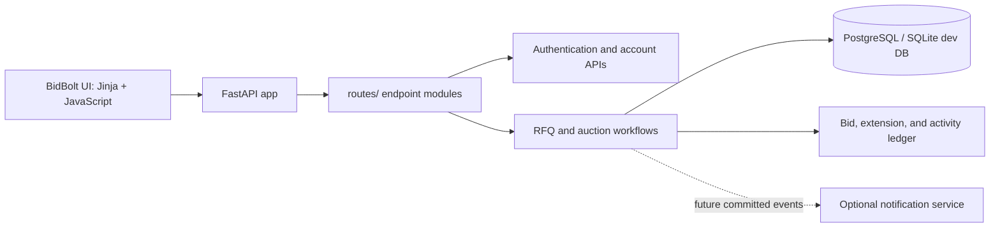

# BidBolt — Better routes. Better bids. Better business.

BidBolt is a buyer and supplier freight marketplace built with FastAPI, async SQLAlchemy, Jinja, and browser JavaScript. Buyers publish RFQs and suppliers find work that matches their routes and service capabilities, then compete in a British reverse auction. The canonical comparison amount is `freight_charges + origin_charges + destination_charges`, stored as `NUMERIC(18,2)`. Ranking uses each supplier's best accepted quote, then earliest server-side acceptance time, then bid ID for deterministic ties.

## Architecture

The application is a modular monolith. `main.py` only creates the FastAPI app; `core/app_factory.py` configures it, and HTTP error and security behavior live under `core/`. All endpoint paths and handlers live under `routes/`, grouped by authentication, RFQs, buyer/supplier APIs, administration, and system pages. Business workflows and persistence remain in focused modules. Browser helpers live in `static/js/utils/`, with the UI entry point in `static/js/app.js`.



The database is the source of truth. A bid transaction locks the RFQ row where the database supports row locks, checks the database/server deadline, validates a strictly lower supplier quote, recalculates rankings, applies the configured extension if eligible, and writes audit records before commit. `idempotency_key` is unique per supplier/RFQ so safe client retries do not create duplicate submissions.

## Freight categories and marketplace filters

Suppliers save supported transport modes and services in their account profile. The current modes are road, air, ocean, rail, multimodal, and courier. Services include full and less-than-truck/container loads, reefer, hazmat, oversized freight, express, customs, warehousing, and last mile.

Buyers choose one or more transport modes and optional services when creating an RFQ, and can include origin, destination, pickup date, and remarks. Buyers and suppliers can filter their RFQ lists by mode, service, origin, destination, pickup-date range, status, accepted quotes, notes, and auctions closing within 24 hours. Suppliers can also match saved capabilities. Bid detail filters show each supplier’s current best quote and the top three ranks. Selected filters apply immediately and appear as active chips. Admins can filter and inspect auctions and bids across the marketplace.

## Dashboards and analytics

Buyer and supplier workspaces include a role-aware sidebar, overview metrics, 14-day activity charts, paginated RFQ lists, paginated quote history, and account settings. Buyer analytics count only that buyer’s RFQs and received quotes. Supplier analytics use only that supplier’s quotations and leading ranks. The senior-admin dashboard shows global account, RFQ, and quote metrics, with paginated user and auction directories and per-account activity views.

## Business rules

- Auction IDs are assigned by the server from the database sequence; buyers enter the auction name, schedule, and supplier-facing remarks, not an ID.
- Buyer remarks are stored with the RFQ and shown in buyer and supplier detail views. Account history records buyer RFQ creation and supplier quotation submissions.
- Buyer lists and detail views are scoped to RFQs owned by that buyer. Suppliers can browse RFQs and see only their own quote amounts.
- All API timestamps must include a timezone and are normalized to UTC.
- An auction starts at `bid_start_at`, naturally closes at `current_close_at`, and becomes `force_closed` at `forced_close_at`. The forced deadline is absolute.
- A supplier may submit a new bid only when it is strictly below that supplier's best accepted quote.
- L1/L2/L3 are calculated from one best accepted quote per supplier. Ties use earliest accepted server-side timestamp, then bid ID.
- Extension modes are `bid_received`, `rank_change`, and `l1_change`. The trigger window is evaluated relative to the current close, repeated extensions are allowed, and close time is capped at the forced close.
- Buyers can see all accepted quotation details. Suppliers can see auction progress and their own accepted quotations, but not competitor quote details.

## Local setup

Requires Python 3.12+ and [uv](https://docs.astral.sh/uv/).

```powershell
Copy-Item .env.example .env
# Set SECRET_KEY in .env to a generated value, for example:
python -c "import secrets; print(secrets.token_urlsafe(48))"
uv sync
uv run alembic upgrade head
uv run fastapi dev main.py
```

Open http://localhost:8000. Public signup lets users choose a buyer or supplier account. Weak-password choices prompt a recommendation modal but remain allowed. Buyer dashboards show only RFQs created by that buyer; supplier dashboards show the filtered RFQ marketplace. Both roles have an account page, analytics, and paginated activity history.

## User data and senior administration

Create or promote the senior administrator with `uv run python scripts/create_admin.py`. The script prompts for username, email, and a hidden password, then stores only an Argon2 password hash. The admin portal at `/admin` includes marketplace analytics, auction and bid oversight at `/admin/auctions`, and a searchable, filterable account directory at `/admin/users`. User and quote history pages are paginated. Browser requests without admin access receive a Jinja HTML error page.

The OpenAPI docs group role-specific account APIs under **Buyers**, **Suppliers**, and **Admin**. Buyers use `GET /api/buyers/me`, `/api/buyers/me/activity`, and `/api/buyers/me/analytics`; suppliers use `GET /api/suppliers/me`, `/api/suppliers/me/activity`, and `/api/suppliers/me/analytics`, and can save capabilities with `PUT /api/suppliers/me/capabilities`. Activity endpoints and RFQ bid details accept page parameters and return totals and `has_more`. Admin-only endpoints include `GET /api/admin/analytics`, `/api/admin/users`, `/api/admin/buyers/{id}`, and `/api/admin/suppliers/{id}`. Buyer, supplier, and admin detail responses have separate schemas; none include password hashes. Buyer and supplier endpoints are scoped to the signed-in person, and admin endpoints require the senior-admin flag.

## Docker

```powershell
# Set SECRET_KEY in .env before starting; Compose refuses its known-default fallback.
docker compose up --build
```

PostgreSQL data is persisted in the `postgres_data` volume. The container runs `alembic upgrade head` before starting FastAPI, runs as a non-root user, does not bake secrets into the image, and exposes `/health`.

### Free-tier deployment notes (checked 2026-11-20)

For a demo or evaluation deployment, run the Docker image as a Render Free Web Service and point `DATABASE_URL` at a separate managed PostgreSQL provider. Render Free Web Services sleep after 15 minutes without inbound traffic, have an ephemeral filesystem, and may take about a minute to wake; therefore do not put the authoritative auction database on local SQLite in that environment. Render's own Free Postgres is limited to 1 GB, expires after 30 days, and has no backups, so it is not the durable choice for this database. See [Render's free deployment limits](https://render.com/docs/free).

Supabase Free is a practical PostgreSQL option for a small demo: the current published limits include 500 MB database size, 5 GB egress, two free projects, and pausing after one week of inactivity; automatic backups are not included. Treat it as evaluation infrastructure, keep the database URL in host secrets, and plan backups/upgrades before production use. See [Supabase billing limits](https://supabase.com/docs/guides/platform/billing-on-supabase) and [database size behavior](https://supabase.com/docs/guides/platform/database-size).

## Tests

```powershell
uv run pytest -q
```

The test suite uses a temporary SQLite database and covers API authorization, freight capability updates and filters, bid filters and pagination, role-scoped analytics, admin directory and auction oversight, monetary precision, rank/tie behavior, trigger modes, forced-close rules, idempotent retries, and concurrent submission coverage.
